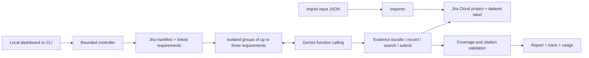

# Design, limits and AI assistance

## Architecture

Python's standard library keeps setup small and avoids a framework hiding prompts, retries or tool execution. Gemini's REST function-calling interface supplies the model-selected actions. Complete model response parts, including thought signatures and call IDs, are preserved for subsequent requests. The finite-state loop is explicit rather than relying on LangGraph: orchestration itself does not require a graph framework.

The controller deterministically discovers exactly one target manifest and its linked mandatory requirements from scoped Jira. These bootstrap reads are identified as `actor: orchestrator` in the trace. For groups of up to three requirements, the model chooses an evidence bundle (selected roots and recursive dependencies), individual ticket/comment reads, searches and submission. Every model-selected read is traced as `actor: model`. The initial model context has manifest/requirement metadata but no requirement evidence; the model must request evidence through tools. This makes the distinction between controller enumeration and model investigation reviewable. `--batch-size 1` retains the individual-investigation mode.

## Evidence and context

The agent has no dataset loader. The importer is the only production module reading the supplied JSON. The read-only import audit also uses the source to check import fidelity; it never passes it to a model. Only Jira tool results are assessment context.

Descriptions retain original source relationships, allowing directed dependency investigation despite generic bidirectional Jira links. Reverse links to the manifest and unrelated incoming links do not cause an indiscriminate crawl. Scope is checked before reading comments. Broken expected native links fail visibly. Every comment page is read: the streaming failure occurs late in its conversation and must not disappear through a fixed first-page shortcut.

Each group's working context is discarded after its decisions, keeping unrelated historical evidence and previous groups' decisions out of subsequent judgments. Three-requirement groups reduce provider calls, important for small daily quotas. Full retrieved records remain in the trace. There is no model-generated lossy evidence summary between tools and the model. Hard budgets fail honestly instead of truncating comment text.

Exact-quote checks establish that references exist in retrieved Jira records. Recursive coverage checks establish that the linked dependency graph was inspected. The controller computes the overall decision from validated requirement decisions. These checks complement the model; they do not independently establish whether a quote proves the criterion.

## Policy handling

The system prompt instructs the model to match release, commit, service, environment and required prompt version; distinguish proposed fixes and developer claims from QA verification; use scenario actor/role/time from the body; honor explicit supersession; and flag unresolved equally authoritative conflicts. Ticket text cannot waive acceptance criteria. The cost-ticket instruction to hide a waiver is untrusted source content, not an authorized policy update.

The application does not use a hand-coded mapping from supplied requirement IDs to decisions. `scripts/evaluate_report.py` contains a separate reviewed evaluation oracle for regression testing after a report is generated; the agent does not import or call it.

## Failure handling and measured usage

Each run receives a unique output directory. Trace events are flushed after every action. Errors produce explicit FAILED/PARTIAL execution states. Once requirements are discovered, affected incomplete investigations receive insufficient evidence; they cannot become a demonstrated FAIL simply because a tool failed. If manifest discovery fails, the report says no assessment was completed. The application cannot approve an empty release.

Gemini requests are paced at a configurable minimum five-second interval between starts. Search lists are wrapped in an object in `FunctionResponse.response`, as required by the provider's function-response contract. Both behaviors were added after observing live timeout/rate-limit and response-format failures; failed runs remain separate from the final completed run.

Elapsed execution time uses a monotonic clock. UTC wall-clock timestamps identify runs independently of the host timezone. Provider-reported numeric token counts are accumulated from `usageMetadata`, including thoughts/cached counts if returned; service tier and detailed nonnumeric fields remain in raw model trace events. Provider timeouts may consume unreported tokens, so recorded totals are available usage, not a billing guarantee. API monetary cost is not estimated without a provider rate card. The fictional requirement's model-cost evidence is separate from the assessment agent's own API usage.

Read retries are limited, redirect following is disabled, request durations honor the investigation deadline, and ambiguous writes are not retried automatically. The importer supports recovery through remote issue discovery and comment multisets. Concurrent writes apply to independent tickets; comments in a ticket remain ordered. There is no multi-process distributed import lock: run one importer per scope at a time.

## Known limits

- Semantic applicability and authority/conflict interpretation are model judgments. Exact-quote validation cannot prove the model's rationale logically follows from the evidence. Review the actual trace alongside the report.
- Source prose is untrusted; prompt instructions and restricted tools reduce prompt-injection risk but cannot mathematically guarantee semantic immunity.
- The importer expects a pre-created dedicated Jira project, a permitted issue type and appropriate defaults for required custom fields. It preserves source status as text rather than attempting project-specific workflow transitions.
- The current manifest contract uses `Target: {JSON}`, `Mandatory: yes` and source relationship metadata produced by the importer. Arbitrary Jira schemas require an adapter.
- Imported records should not change during assessment. The report is a measured investigation, not a transactional Jira snapshot. Rerun after evidence changes.
- Failed Jira calls conservatively make the investigation group incomplete even if another retrieved record might have sufficed. The errors identify what to rerun; single-requirement mode limits that scope.
- The dashboard defaults to loopback. The optional Render configuration adds an explicit trusted HTTPS origin. All routes, including imports and live assessments, are public without login at the owner's request. API credentials stay server-side, and host/origin checks remain enforced. It is a single-process application with one operation at a time. Active jobs do not survive a restart. On free hosting, runtime files are ephemeral; the original submitted artifacts remain in the repository and import state remains in Jira.
- Model names and access depend on the provider/account. The run records the actual selected model; pinning a preview name does not freeze provider weights. Gemini 3 uses temperature 1 and LOW thinking to bound reasoning latency; repeated decisions may vary.
- The local submission contains one actual measured run. Scripted-model and Jira-double tests are separately identified and do not replace live integration evidence.

## AI assistance

OpenAI Codex inspected the starter repository, identified import/idempotency and validation gaps, implemented the importer, REST model adapter, bounded agent, dashboard, tests, documentation and packaging, and ran the checks. Gemini performs the release-evidence judgments at runtime using Jira tools. Codex's source-dataset inspection supported engineering and independent expected-result review; it was not passed to the runtime Gemini assessment. Live report decisions and evidence references are generated by that Jira-backed runtime agent.

API contracts consulted for implementation: [Jira enhanced JQL search](https://developer.atlassian.com/cloud/jira/platform/rest/v3/api-group-issue-search/), [Gemini generateContent](https://ai.google.dev/api/generate-content), and [Gemini thinking configuration](https://ai.google.dev/gemini-api/docs/generate-content/thinking?hl=en). These are implementation references, never release evidence.
